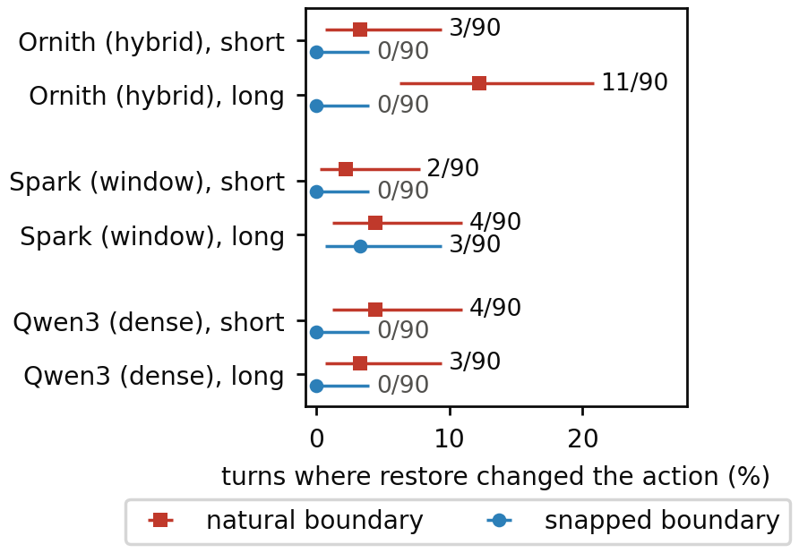
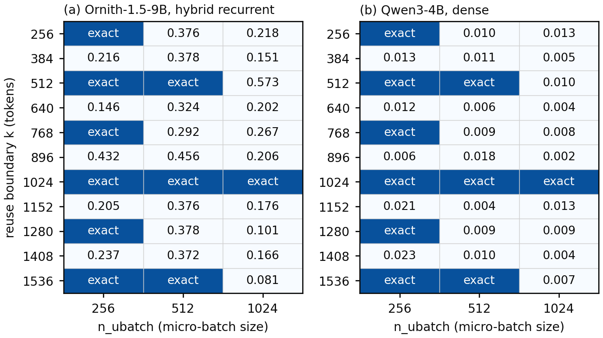
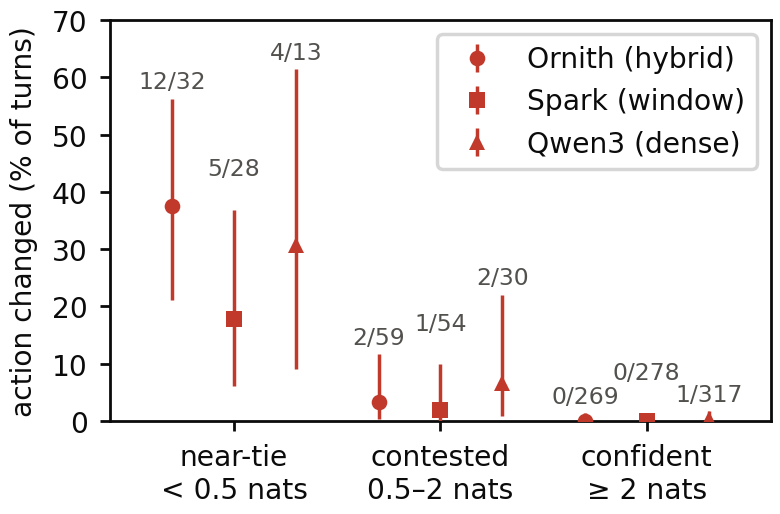
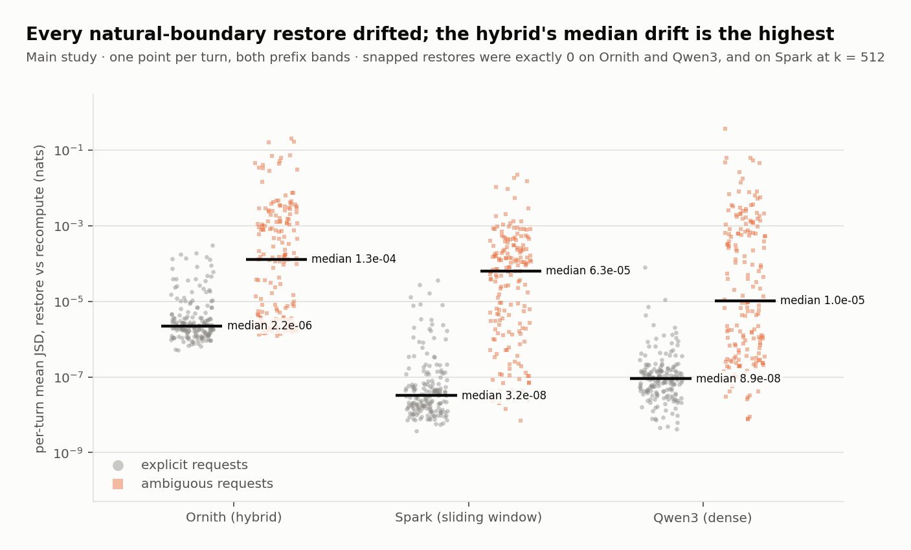

# driftmatrix

**Does serving an LLM agent from a restored prompt cache change what the agent does?**

A pre-registered measurement of prompt-cache fidelity in llama.cpp, across hybrid
recurrent, sliding-window and dense models, on agent-shaped traffic with real
tool calls.



*Restore changed the agent's action on ambiguous requests, on every architecture.
90 turns per point, both replicates; 95% Clopper–Pearson intervals. Explicit
requests: 0 changes in 1,080 restores.*

## Result

On llama.cpp build `b10839` (Q4_K_M weights, one RTX 4060 Laptop GPU, greedy
decoding), with 360 agent turns per model:

- **Restoring saved state at a natural agent-turn boundary was never bit-exact**,
  on any of the three architectures (1,080 of 1,080 turns).
- **It changed the agent's action on 2–12% of ambiguous requests, on all three
  architectures.** The changes were a different argument list, a tool call that
  became a text reply, or a clarifying question that became a tool call. It
  changed **none** of the 540 explicit-request turns, each restored at two
  boundaries. The hybrid recurrent model changed most: 11 of 90 long-history
  turns.
- **Changes happen where the model was already close to a tie**: in 29% of turns
  where its top two choices were within 0.5 nats, against 0.1% of confident turns.
- **The fix works on two of the three architectures.** Rounding the reuse boundary
  down to a multiple of the engine's micro-batch size (`n_ubatch`) made every
  restore bit-exact on the hybrid and dense models, at a median cost of 158–443
  re-evaluated tokens. On the sliding-window model it worked at 512 tokens and
  failed at 4,096.
- **The prediction that dense and sliding-window models would be unaffected was
  wrong**, and is reported as such.

Full write-up: [`docs/findings/2026-09-11-main-study.md`](docs/findings/2026-09-11-main-study.md)

## Why this matters

Agent frameworks resend the same system prompt, tool schemas and growing history
on every turn, so serving stacks restore cached model state for nearly every
request. Production agent traces show 94–96% of prompt tokens served from cache
(TraceLab, arXiv 2606.30560). That optimization is assumed to be invisible.
llama.cpp's own documentation warns that cached logits "are not guaranteed to be
bit-for-bit identical", but the questions that matter for agents were open:
when is reuse exact, how much does it depend on the architecture, and does it
change what an agent does?

## The mechanism

Restoring a saved state returns identical bytes, so the restore itself cannot
introduce a difference. The difference comes from how the prompt is split into
micro-batches. llama.cpp evaluates prompts in physical micro-batches of `n_ubatch`
tokens:

- **Recompute** tiles the whole prompt from position 0: `[0, U) [U, 2U) …`
- **Restore** tiled the prefix `[0, k)` when it was cached, then tiles the suffix
  afresh from `k`.

The two tilings coincide only when `k` is a multiple of `n_ubatch`. Otherwise
matrix multiplications, attention and the recurrent scan accumulate
floating-point error in a different order, and addition is not associative.



*Restore is bit-exact exactly when the reuse boundary is a multiple of
`n_ubatch`. Gate G1, one ~1.9K-token prompt per model; inexact cells show the
worst-position total variation against recompute.*

Gate G1 tested this directly by changing `n_ubatch`. The set of exact boundaries
moved with it: all 66 restores matched the prediction, on a hybrid and a dense
model. The hybrid's inexact cells are about 26× larger by median, because its
recurrent state carries the difference forward instead of letting it stay local.

## Study design

- **Architecture ladder, quantization-matched (Q4_K_M):**
  - Ornith-1.5-9B: hybrid, linear attention plus full attention, recurrent state
  - Spark-X2.5-4B: sliding window of 512 tokens plus full attention
  - Qwen3-4B: dense
- **Agent traffic:**
  - 90 base conversations with real tool round trips against deterministic
    mock tools, rendered through each model's own chat template with tools.
  - Each conversation appears with a short history (8 round trips, about 1K
    tokens) and a long one (60 round trips, about 4–6.5K tokens), and ends with
    either an explicit request ("Look up record 153") or an ambiguous one ("Add
    up the numbers from earlier").
  - That makes 360 turns per model, and every model gets the same turns.
- **Six arms per turn:** recompute, restore at the natural turn boundary, and
  restore at the snapped boundary, each run twice.
- **Outcome:** the agent's action, meaning a tool call with canonical arguments or
  no call. A secondary outcome is distribution drift (JSD) at context-matched
  positions. The recompute arm's action margin (top-two logprob gap at the
  decision) is a covariate.
- **Pre-registered:** outcomes, three Holm-corrected test families, decision rules
  and a null-result commitment were frozen in a tagged commit
  ([`docs/preregistration/`](docs/preregistration/2026-09-10-analysis-plan.md))
  before any main-study turn ran. The analysis code was committed and tested
  before the run, too.

## How the measurement is kept honest

- **Every arm is proven, not assumed.** llama-server can silently reprocess a
  "restored" prompt, and a host-side cache can hand a "recompute" state it never
  computed. So each restore must show, in the server's own `timings.prompt_n`,
  that it evaluated only its suffix; each recompute must show it evaluated
  everything; and each saved slot must hold exactly `k` tokens. All 6,480 arms
  passed.
- **The noise floor is measured, not assumed.** Recompute ran twice on every turn
  and was bit-exact every time, so any difference is attributable to restore.
- **Tool-call parsers are validated against the model itself.** A parsed call must
  reproduce the model's exact `<tool_call>` text when written back through its
  chat template. All 161 do. It also exposed a llama-server behaviour: its tool-call
  grammar forces required arguments into schema order, which changed what Spark's
  tool received ([details](docs/findings/2026-09-11-spark-argument-order.md)).
- **Offline prompt rendering is checked against the server**, byte for byte
  without tools and token for token with tools. The check revealed, for example,
  that jinja2's `tojson` sorts keys and HTML-escapes, which would silently rewrite
  every tool schema.
- **Blinded, resumable runner.** It prints only arm validity while it runs, writes
  whole turns atomically, and refuses a server with the wrong build or model. The
  analysis script refuses to run until all three models are complete.
- **Gates before the study:** G0 (the state API works), G1 (the mechanism), G2 (the
  prompts and parsers are right) and G3 (a pilot on separate turns: snapped
  restores exact, the positive control visible).
- **GPU-free test suite**, including a fake server in which micro-batch tiling is
  the only cause of divergence.

## More results



*Changes happen where the model was already close to a tie. Natural boundaries,
all turns; the action margin is the smallest top-two log-probability gap at the
decision, on the recompute arm; 95% Clopper–Pearson intervals.*



*Every natural-boundary restore drifted; the hybrid's median drift is the
highest. One point per turn, both prefix bands; black bars are medians. Snapped
restores were exactly 0 on Ornith and Qwen3, and on Spark at k = 512.*

| Pre-registered hypothesis | Verdict |
|---|---|
| H1 Snapped restores are bit-exact | Holds on hybrid and dense; **fails on sliding window** at k = 4,096 |
| H2 Restore shifts the hybrid's output distribution | Supported |
| H3 Restore changes the hybrid's actions | Partial: on ambiguous requests, not explicit ones |
| H4 The hybrid diverges more than the controls | Partial: more than sliding window; more than dense on 291 of 360 turns, but not on average |
| H5 Snapping helps, more on the hybrid than the dense model | Partial: helps; no larger on the hybrid |
| H6 Divergence compounds with prefix length | Not supported |
| H7 Action changes concentrate in ambiguous requests | Supported |

## What turned out differently than planned

- **The controls were not immune.** The dense and sliding-window models changed
  actions at rates similar to the hybrid's on short histories. Restore-induced
  action changes are a property of near-tie decisions, not of recurrent state
  alone.
- **Snapping does not protect the sliding-window model beyond its window.** It was
  exact at 512 tokens (the window size) and inexact at 1,024 (G0) and 4,096 (all
  180 long-band turns). A [follow-up](docs/findings/2026-09-11-spark-window.md)
  that varied `n_ubatch` isolated the rule: with default flash attention, a
  restore is exact only when the boundary is aligned *and* inside the 512-token
  window (0 contradictions in 39 cases). Turning flash attention off extends
  exactness to 2,560 tokens but not beyond. Without `--swa-full`, the server
  silently discarded every restore, which the arm proofs caught. The underlying
  cause in llama.cpp is located, not explained.
- **Qwen3's chat template re-renders the previous assistant turn** once a new user
  message arrives, so its history is never a token prefix of the next prompt.
  Requiring a full prefix would have silently dropped the dense baseline. The reuse
  boundary is instead defined as the longest common token prefix, which is what a
  server actually reuses.
- **A suspected llama.cpp parser bug was the grammar.** G2 first blamed a shortened
  tool argument on llama.cpp's parser. Reproducing it inside llama.cpp showed the
  parser was right: the tool grammar forced Spark to write its arguments in schema
  order, and the model wrote a different argument. A pending upstream fix,
  [llama.cpp PR #26472](https://github.com/ggml-org/llama.cpp/pull/26472), resolves
  it; testing that PR found a regression for the Laguna-XS templates, reported on
  the PR with a failing test and a change that passes all parser tests.
- **The planned statistics contradicted the planned power.** Holm-corrected sign
  tests needed 9 changed turns out of 90 to detect anything. Because the
  recompute floor is bit-exact, the pre-registration uses an exact test against a
  zero floor, with Clopper–Pearson intervals.

## Scope and limits

- One engine build, one quantization, one GPU, `n_ubatch = 512`. Exactness is a
  property of kernels and can differ elsewhere.
- Synthetic agent traffic: three mock tools and five ambiguous request types. The
  margin relationship is the part expected to transfer.
- Rates rest on 2–11 events per condition, so the intervals are wide.
- Greedy decoding only. No claims about vLLM or SGLang.

## Reproducing

```bash
pip install -e ".[dev]"
pytest -q                                      # GPU-free

# start the server with the pre-registered flags (add --swa-full for Spark)
llama-server -m <model.gguf> --jinja -c 8192 -ngl 99 -np 1 -b 2048 -ub 512 \
  --cache-ram 0 --ctx-checkpoints 0 --slot-save-path <slot-dir> --port 8090

python scripts/study_manifest.py --model ornith --gguf <model.gguf>                    # token budget, no generation
python scripts/run_study.py --pilot --model ornith --gguf <model.gguf> --slot-dir <slot-dir>   # gate G3
python scripts/run_study.py --model ornith --gguf <model.gguf> --slot-dir <slot-dir>           # main study, resumable

python scripts/analyze_study.py --gguf ornith=<...> --gguf qwen3=<...> --gguf spark=<...>
python scripts/make_figures.py                 # figures from committed results
```

Models: `ornith`, `qwen3`, `spark`. The gate scripts (`g0_server.py`,
`g1_server.py`, `g2_render_check.py`, `g2_toolcalls.py`) document their own
usage.

## Repository map

| Path | Contents |
|---|---|
| [`docs/findings/`](docs/findings/) | One write-up per gate and for the main study, with raw reports |
| [`docs/preregistration/`](docs/preregistration/2026-09-10-analysis-plan.md) | The frozen analysis plan (tag `prereg-2026-09-10`) |
| [`docs/superpowers/specs/`](docs/superpowers/specs/2026-09-10-hybrid-cache-fidelity-design.md) | Design spec and its revision history (v1–v4.5) |
| `src/driftmatrix/runner/llamaserver.py` | Stdlib llama-server client and arm proofs |
| `src/driftmatrix/servergrid.py`, `analysis.py` | Main-study runner and pre-registered analysis |
| `src/driftmatrix/traces/` | Conversation generator, offline chat-template rendering, reuse boundaries, tool-call parsers and round trip |
| `src/driftmatrix/stats/` | Exact tests, Clopper–Pearson, paired bootstrap, Holm families, power |
| `src/driftmatrix/g0.py` … `g3.py` | The gates |

## Prior art

- **llama.cpp server README, `cache_prompt`** documents that cached logits may
  differ from fresh ones. This project does not claim that caching *can* change
  output; it measures when, by how much, and with what behavioural consequence.
- **Thinking Machines Lab, "Defeating Nondeterminism in LLM Inference"** (2025):
  batch invariance in general, shipped in vLLM as `VLLM_BATCH_INVARIANT`.
- **TraceLab** (arXiv 2606.30560), **vLLM × Mooncake**, **Policy-Driven Runtime
  Layer** (arXiv 2605.27744): agent-workload cache characterization, all measuring
  speed.
- **LMCache hybrid-model documentation** notes that generation is not bit-exact
  between cached and fresh runs on GDN backends, without quantifying it.
- **llama.cpp #20225**, **vLLM #43587, #40696, #26201**, **SGLang #21846**: hybrid
  prefix-caching limitations on three engines.

## License

Code is under the [MIT License](LICENSE). The recorded runs, analysis outputs and
figures in `docs/findings/` and `docs/figures/` are under [CC BY 4.0](LICENSE-DATA);
please cite the repository (see `CITATION.cff`) if you reuse them.
